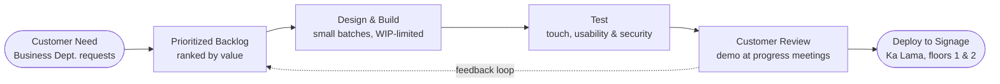

# Agile Methodology: Lean

> ICS 418 Agile Project · Team C · UHMC Business Department Digital Signage

## Overview

Our team selected **Lean** as the Agile methodology for this project. Lean, rooted in the Toyota Production System, focuses on **maximizing customer value while eliminating waste**. Work is delivered in small increments, validated with the customer, and improved continuously.

## Lean Principles and How We Apply Them

| # | Principle | What it means for this project |
| --- | --- | --- |
| 1 | **Eliminate Waste** | Build only what the customer values; cut unused features, waiting, and rework. |
| 2 | **Amplify Learning** | Learn through prototypes and customer feedback instead of guessing. |
| 3 | **Decide as Late as Possible** | Keep options open on "TBD" features until we have real input. |
| 4 | **Deliver as Fast as Possible** | Get small, working pieces onto the signage early and often. |
| 5 | **Empower the Team** | Each member owns their tasks and the decisions within them. |
| 6 | **Build Integrity In** | Test as we go so the kiosk is reliable, secure, and easy to use. |
| 7 | **Optimize the Whole** | Design for the full user experience, not features in isolation. |

## Development Plan

### Why Lean fits our project

- **Small team, tight timeline:** Three people and eight weeks leave no room for wasted effort.
- **Customer-defined value:** Vincent Domingo and the Business Department decide what matters most.
- **Evolving requirements:** "TBD" features can wait until we have real feedback.
- **Early, visible progress:** Small increments give the customer something to react to sooner.
- **Continuous improvement:** Fits our weekly progress updates and check-ins.

### How we'll apply it

- **MVP first:** Program promotion, building directory, and UHMC website access.
- **Small batches:** Add job postings, surveys, and event ads one at a time.
- **Customer validation:** Demo each increment at our Week 9, 11, and 13 meetings.
- **Visual workflow:** Track tasks on our Kanban board with WIP limits.
- **Weekly retrospectives:** Review what's slowing us down and remove it.

## Value Stream Map

How a feature moves from customer need to the signage:

### Waste we'll watch for

| Waste | Example | Fix |
| --- | --- | --- |
| **Waiting** | Delays for approvals or content | Regular customer check-ins |
| **Extra Features** | "Nice-to-haves" no one asked for | Stick to the prioritized backlog |
| **Rework** | Misunderstood requirements | Confirm mockups before building |
| **Task Switching** | Juggling too many items at once | Enforce WIP limits on the board |

## Kanban Workflow

Work is tracked on our team Kanban board *(link: TBD)*. Cards are **pulled** into the next column only when there is capacity.

| Column | WIP Limit | Purpose |
| --- | --- | --- |
| Backlog | — | All features and tasks, ranked by customer value |
| To Do | 3 | Next items the team has committed to |
| In Progress | 3 | Actively being built |
| Review / Test | 2 | Peer review and testing on the touchscreen |
| Done | — | Meets our Definition of Done |

*WIP limits are a starting point; we'll adjust them to match our board.*

**Definition of Done:** the item is tested on a touchscreen layout, reviewed by a teammate, and merged into the `main` branch.

## Metrics

| Metric | What it tells us |
| --- | --- |
| **Cycle time** | How long an item takes from start to done |
| **Throughput** | How many items we finish each week |
| **WIP adherence** | Whether we're overloading ourselves |
| **Customer feedback** | Whether what we build matches what the customer wants |

## Weekly Cadence

- **Progress update:** Share progress, challenges, and next steps with the instructor each week.
- **Retrospective:** What slowed us down? What waste did we see? What will we change next week?

## Timeline

| Week | Focus |
| --- | --- |
| 8 | Team formation, goal setting, customer meetings, and planning |
| 9 | Customer meeting, idea solidification, begin programming, process documentation |
| 10 | Continue initial programming using Lean practices |
| 11 | Continue programming; progress meeting with customer |
| 12 | Continue programming, potential testing, move into feature development |
| 13 | Refine working prototype for final testing; progress meeting with customer |
| 14 | Prototype testing, bug fixes, security refinements, final improvements |
| 15 | Finalize project prototype; final presentation |
